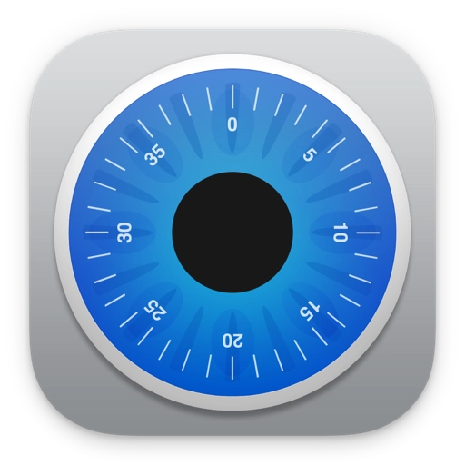

<p align="center">
  
</p>

# Memory Cleaner Lite

Windows 托盘常驻内存清理工具（Rust）。监控物理/提交内存与 CPU、网速，通过 NT 内存管理 API 请求回收。设置在**托盘右键菜单**完成。多数清理操作需要管理员权限。MIT。

二进制 `MemoryCleanerLite.exe`，配置 `%APPDATA%\MemoryCleanerLite\`。

## 功能

- **一键清理**：托盘左键 / 全局热键 / 二次启动唤醒
- **清理区域**：工作集、系统文件缓存、已修改页面、待机列表（普通/低优先级互斥）、合并页面、已修改文件缓存
- **自动清理**：Windows 低内存通知 + 可选物理内存占用阈值
- **托盘菜单**：区域、自动清理与阈值、开机自启、通知、调试日志、热键开关、任务栏条、语言、打开配置目录
- **任务栏条**：通知区左侧 2×2（↑/↓/CPU/RAM）
- **全局热键**：默认 `Ctrl+Alt+C`（开关在菜单；组合键改 `settings.toml`）
- **单实例**：已运行时再次启动触发清理
- **配置**：`%APPDATA%\MemoryCleanerLite\settings.toml`

## 构建

```bash
just build          # clippy + release
cargo run --release
```

产物：`target/release/MemoryCleanerLite.exe`

## 配置项

| 键 | 类型 | 默认 | 说明 |
|---|---|---|---|
| `run_at_startup` | bool | `false` | 登录后最高权限计划任务托盘启动 |
| `memory_areas` | u32 | `43` | 清理区域位掩码 |
| `show_optimization_notifications` | bool | `true` | 清理完成 Toast |
| `language` | string | `"auto"` | `auto` / `zh-CN` / `en` |
| `debug_logging` | bool | `false` | 写入 exe 旁 `App.log`（单文件 ≤ 2 MiB） |
| `cleanup_hotkey_enabled` | bool | `true` | 全局热键开关 |
| `cleanup_hotkey` | string | `"Ctrl+Alt+C"` | 热键组合 |
| `auto_cleanup_enabled` | bool | `false` | 自动清理 |
| `auto_cleanup_threshold` | u32 | `0` | 物理内存占用阈值；`0` 仅低内存通知 |
| `show_taskbar_window` | bool | `true` | 任务栏指标条 |
| `taskbar_font_point_size` | u32 | `13` | 任务栏字体磅值（8–28） |

未识别的配置键加载时忽略，保存时丢弃。首次运行、缺键或无标准注释头时写入带中英注释的完整默认项，便于手改。

## 开发

```bash
just format
just check
just test
```

详见 `AGENTS.md`、`docs/CHANGELOG.md`。
