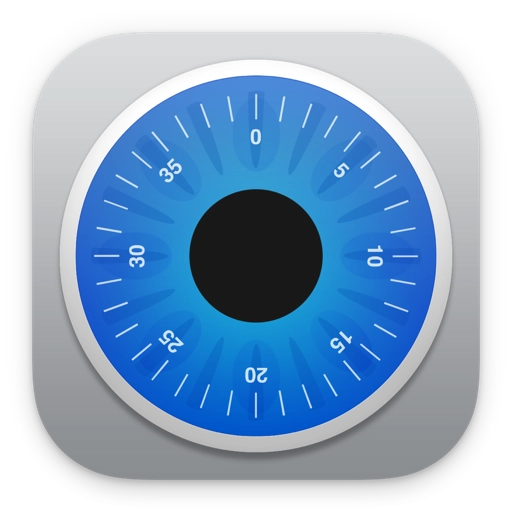

<p align="center">
  
</p>

# Memory Cleaner Lite

Windows tray-resident memory cleaner (Rust). Monitors physical/commit memory plus CPU and network, and requests reclamation via NT memory-management APIs. Settings live in the **tray context menu**. Most cleanup steps need administrator rights. MIT.

Independent from full **Memory Cleaner**: binary `MemoryCleanerLite.exe`, config `%APPDATA%\MemoryCleanerLite\`, can run side by side.

## Features

- **One-shot cleanup**: tray left-click / global hotkey / second-instance wake
- **Cleanup areas**: working set, system file cache, modified page list, standby list (normal/low-priority mutually exclusive), combined pages, modified file cache
- **Automatic cleanup**: Windows low-memory notification + optional physical-usage threshold
- **Tray menu**: areas, auto-cleanup and threshold, run at startup, notifications, debug log, hotkey toggle, taskbar strip, language, open config folder
- **Taskbar strip**: 2×2 (↑/↓/CPU/RAM) left of the notification area
- **Global hotkey**: default `Ctrl+Alt+C` (toggle in menu; chord in `settings.toml`)
- **Single instance**: a second launch triggers cleanup on the running process
- **Config**: `%APPDATA%\MemoryCleanerLite\settings.toml`

## Build

```bash
just build          # clippy + release
cargo run --release
```

Artifact: `target/release/MemoryCleanerLite.exe`

## Settings

| Key | Type | Default | Notes |
|---|---|---|---|
| `run_at_startup` | bool | `false` | Highest-privilege logon task, tray only |
| `memory_areas` | u32 | `43` | Cleanup area bitmask |
| `show_optimization_notifications` | bool | `true` | Toast when cleanup finishes |
| `language` | string | `"auto"` | `auto` / `zh-CN` / `en` |
| `debug_logging` | bool | `false` | `App.log` beside the exe (≤ 2 MiB single file) |
| `cleanup_hotkey_enabled` | bool | `true` | Global hotkey on/off |
| `cleanup_hotkey` | string | `"Ctrl+Alt+C"` | Hotkey chord |
| `auto_cleanup_enabled` | bool | `false` | Automatic cleanup |
| `auto_cleanup_threshold` | u32 | `0` | Physical usage %; `0` = low-memory notify only |
| `show_taskbar_window` | bool | `true` | Taskbar metrics strip |

Legacy keys (`always_on_top`, `excluded_processes`, …) are ignored on load and dropped on save.

## Development

```bash
just format
just check
just test
```

See `AGENTS.md` and `docs/CHANGELOG.md`.
